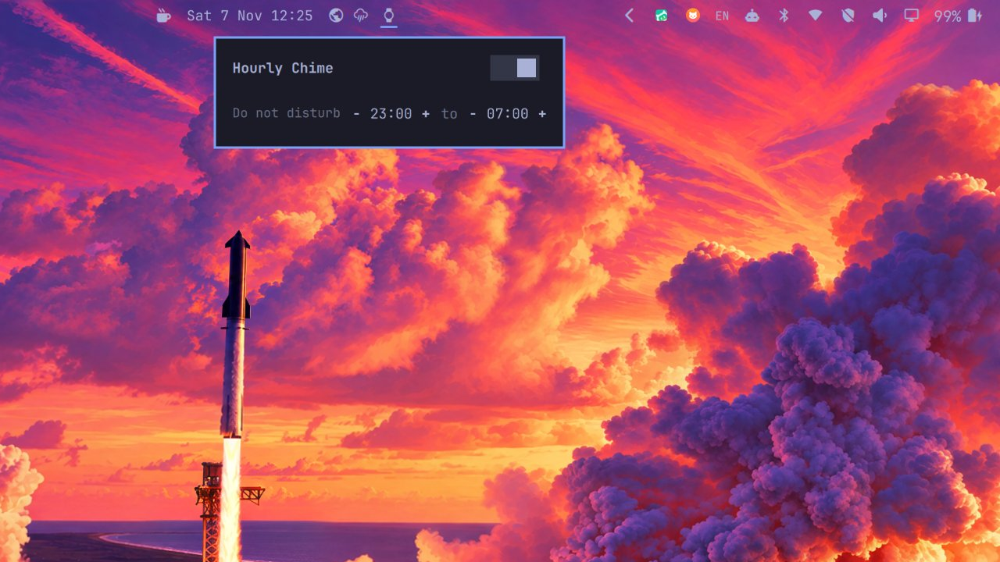

# Omarchy Hourly Chime

A single "beep" at the top of every hour (Casio watch style) plus a notification,
with a configurable do-not-disturb window — as an Omarchy shell bar widget.




## Features

- Watch icon on the bar (bright = chime on, dimmed = chime off), click to open
  the panel
- **Hourly chime**: one 2000 Hz square-wave beep (0.08 s) via `paplay` + a
  notification "It's HH:00"; toggleable in the panel
- **Do-not-disturb window**: −/+ steppers (15 min steps), default 23:00–07:00,
  supports ranges across midnight; the chime stays silent inside it
- **Follows the shell's display language** (Setup > Language): English,
  Simplified and Traditional Chinese ship today, switching needs no restart
- If the laptop sleeps through the chime, it realigns silently on wake —
  no catch-up firing

## Install

This repository root *is* the plugin: `manifest.json`, the QML, the sound and the
language catalogs sit at the top level, which is what `omarchy plugin add`
expects.

```bash
omarchy plugin add https://github.com/kongzong/omarchy-hourly-chime --enable
```

Without `--enable` the repo is cloned and validated but left disabled, so you can
read the code first:

```bash
omarchy plugin add https://github.com/kongzong/omarchy-hourly-chime
omarchy plugin enable com.github.kongzong.hourly-chime
```

The watch appears on the bar once enabled. If it does not, restart the shell
(`omarchy restart shell`). To pick the bar section by hand:

```bash
omarchy plugin disable com.github.kongzong.hourly-chime
omarchy plugin enable com.github.kongzong.hourly-chime --section right
```

`--section` takes `left`, `centerBegin`, `center`, `centerEnd`, `tray` or `right`.

### Manual install

If `omarchy plugin add` cannot reach GitHub on your network, put a copy of this
repository's files into `~/.config/omarchy/plugins/com.github.kongzong.hourly-chime/`
(the directory must contain `manifest.json`), then:

```bash
omarchy-shell shell rescanPlugins
omarchy plugin enable com.github.kongzong.hourly-chime
```

A hand-copied folder has no `.git` metadata, so `omarchy plugin update` will not
manage it — prefer `omarchy plugin add` when it works.

## Update

```bash
omarchy plugin update com.github.kongzong.hourly-chime
```

## Uninstall

```bash
omarchy plugin remove com.github.kongzong.hourly-chime
rm -f "${XDG_STATE_HOME:-$HOME/.local/state}/hourly-chime.json"
```

`omarchy plugin remove` disables the widget first, then deletes the checkout.
The state file (chime on/off and the quiet-hours range) is not removed by the
command above — the second line clears it.

## Re-synthesizing the sound

The sound ships with the repo; to tweak it:

```bash
# Frequency / duration / volume
FREQ=2000 DUR=0.08 VOL=0.25 ./tools/make-chime.sh ./chime.wav
# e.g. a crisper 4096 Hz blip
FREQ=4096 DUR=0.08 ./tools/make-chime.sh ./chime.wav
```

The generator needs `ffmpeg` at authoring time only; the shipped `chime.wav` is
what the widget plays.

## Dependencies

Only components Omarchy 4.x already ships: `quickshell` (omarchy-shell),
`paplay` (PipeWire) and `notify-send`. No extra packages, no network access, no
install hooks, no elevation or root access. All state stays in
`${XDG_STATE_HOME:-~/.local/state}/hourly-chime.json`.

## Languages

The panel, the bar tooltip and the notification follow Omarchy's display
language (`~/.config/omarchy/language`, owned by `omarchy-language` — set under
Setup > Language). Strings live in `i18n/<code>.json`, one flat catalog per
language code from `default/i18n/locales.json`.

English, `zh-CN` and `zh-TW` ship now. Adding a language is one file: copy
`i18n/en.json`, translate the values (keep the keys and the `%1`/`%2`
placeholders), name it after the code — `da.json`, `pt-BR.json`, … A missing
string falls back to `en.json`, then to the English fallback baked into the QML,
so a half-finished catalog is safe to ship. Language switches re-render live, no
shell restart.

The plugin's name in the bar settings stays English: `manifest.json` is not
translated by the shell (first-party plugins are English there too).

## Files

```
.
├── manifest.json          # plugin descriptor (schemaVersion 1)
├── Chime.qml              # bar icon + panel (chime / quiet hours)
├── chime.wav              # 2000 Hz square-wave single beep
├── i18n/                  # display-language catalogs
│   ├── en.json            # base catalog
│   ├── zh-CN.json
│   └── zh-TW.json
├── tools/make-chime.sh           # ffmpeg sound synthesizer (reproducible, tunable)
└── tools/repro-double-chime.mjs  # timer regression replay (`node tools/…`)
```

## History

2.1.1 fixes a timer bug that chimed twice at the top of an hour (once at
`:00.003` and again at `:00.998`) and could skip later hours entirely. Ticks
now align just after the minute boundary and each wall-clock hour is deduplicated.

2.1.0 adds display-language support (English, Simplified and Traditional
Chinese) on top of Omarchy's translation layer.

1.x also shipped a one-shot reminder list (alarm rows with labels). It was
removed in 2.0.0 — the bar icon had to encode three states to reflect both
features, which made a single toggle hard to read. One-shot reminders are
covered by Omarchy's built-in reminders overlay (`omarchy.reminders`). Existing
state files keep working; the stale `alarms` key is dropped on the next save.

## License

MIT — see [LICENSE](LICENSE).
